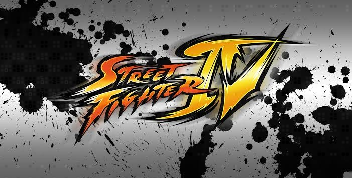
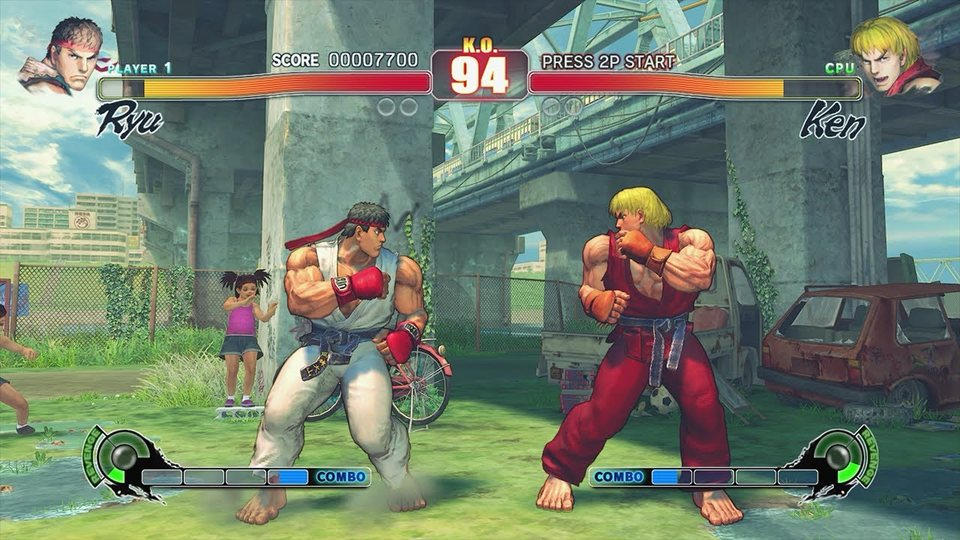
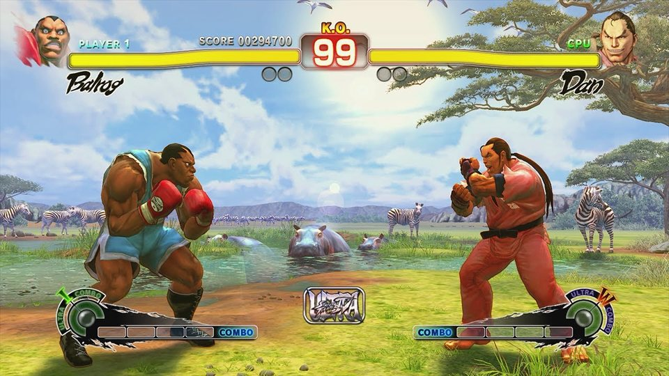

<div align="center">



# Street Fighter IV for Nintendo Switch

**An unofficial native port of the Xbox 360 game, recompiled for the Switch with a Vulkan renderer.**

[](https://jvankooo.github.io/sf4-nx/)
[](https://github.com/jvankooo/sf4-nx/releases)
[](#install)
[](LICENSE)

**[Install](#install)** · **[Features](#features)** · **[Settings](#settings)** · **[How it works](#how-it-works)** · **[Build](#building)** · **[Credits](#credits)**

</div>

<table>
  <tr>
    <td width="50%"></td>
    <td width="50%"></td>
  </tr>
</table>

> [!IMPORTANT]
> **No game files are included.** You need your own copy of *Street Fighter IV* for Xbox 360 (World edition, disc
> image or extracted disc). The installer page makes the SD card folder from it, in your browser.

## Features

|  |  |
|---|---|
| 🎮 **Full speed, 30 fps locked** | The game logic runs its 60 steps per second; the picture is drawn at a steady 30 fps. No slow motion. |
| 🖥️ **Sharp menus, fast fights** | Menus, movies, the HUD and all text at 1280×720; only the 3D scene is rendered at 854×480 and scaled up. |
| 📳 **HD Rumble** | Joy-Con and Pro Controller vibration when you get hit *and* when your hits land, on for both players. |
| ⚡ **Native renderer** | The game's GPU commands are drawn directly with Vulkan (NVK), with the shaders translated ahead of time. |
| 🎬 **Movies and audio** | Bink cutscenes, XMA music and voices decoded on the Switch. |
| 🌐 **Browser installer** | Drop the ISO, get the `sf4-nx` folder. Nothing is uploaded. |

## Install

1. Open the **[installer page](https://jvankooo.github.io/sf4-nx/)** in a desktop browser (Chrome or Edge works best).
2. Drop your `.iso` (or pick the extracted disc folder). The page checks `default.xex` against the supported edition.
3. Click **Create sf4-nx.zip**. It downloads the latest release, translates the game's shaders from your disc with
   WebAssembly and writes the zip straight to your disk.
4. Extract the zip into `sdmc:/switch/` on the SD card:

   ```
   sdmc:/switch/sf4-nx/
   ├── sf4-nx.nro
   ├── sf4.toml                 settings
   ├── sf4_shaders.mesp         the game's shaders, made from your disc
   ├── sf4_shaders.mesp.idx
   └── game_root/               the files of your disc
   ```

5. Launch it in **title takeover** mode: hold **R** while starting any installed game, then pick *sf4-nx* in the
   Homebrew Menu. Applet (album) mode does not give it enough memory.

> [!TIP]
> **Updating:** use **Create sf4-nx-update.zip** with the same disc and extract it over the existing folder. It leaves
> `game_root/` alone but overwrites `sf4.toml`, so keep a copy if you changed it.

## Settings

`sf4.toml` next to the NRO is read at startup. The ones you are most likely to touch:

| Setting | Default | What it does |
|---|---|---|
| `sf4_frame_rate` | `30` | `30`: two game steps per drawn frame (full speed). `60`: one step per frame, as on the Xbox 360; too heavy for the Switch in fights. |
| `video_mode_width` / `video_mode_height` | `1280` / `720` | The resolution the game is told. `854` / `480` renders everything at 480p. |
| `sf4_scene_480p` | `true` | Renders only the 3D scene at 480p, keeping the menus and HUD at 720p. |
| `sf4_vibration_always` | `true` | Rumble on for both players, whatever the in-game button setting says. |
| `sf4_vibration_hit_landed` | `60` | Strength (percent) of the rumble when your hit lands; `0` turns it off. |
| `input_rumble` | `true` | Passes the game's vibration to the controllers at all. |
| `sf4_exclusive_core` | `2` | Gives the game's main thread a CPU core of its own (`-1` = off). |
| `sf4_stack_sampling` | `false` | Diagnosis only: logs where each thread spends its time. |

The `masseffect_*` settings belong to the renderer this port shares with masseffect-nx, not to Mass Effect; the
comments in [`app/sf4.toml`](app/sf4.toml) explain each one.

## How it works

```
 default.xex (PowerPC) ──ReXGlue──► C++ ──devkitA64──► sf4-nx.nro
                                                          │
 game's GPU command buffers (PM4) ──native renderer──► Vulkan (NVK, inside the NRO) ──► Switch GPU
 Xenos shaders on your disc ──XenosRecomp + DXC (installer)──► SPIR-V ──► sf4_shaders.mesp
```

* **Static recompilation.** [ReXGlue](https://github.com/rexglue/rexglue-sdk) translates the game's PowerPC code to
  C++ ahead of time and gives it an Xbox 360 around it: files, memory, threads, audio and controllers.
* **Native renderer.** Instead of emulating the Xenos GPU, the renderer from
  [masseffect-nx](https://github.com/NebadasSwifty/masseffect-nx) reads the game's command buffers and draws the same
  frame with Vulkan. SF4 adds its own handling of predicated tiling, mixed 720p/480p targets and EDRAM resolves.
* **Frame pacing.** The game's update runs twice per presented frame, with the controllers read between the two steps
  so no press is ever seen twice.

The [docs](docs/README.md) go deeper: [native renderer](docs/native-renderer.md), [shaders](docs/shaders.md),
[performance history](docs/performance-history.md), [platform notes](docs/platform-notes.md) and a guide to
[porting another Xbox 360 game](docs/porting-another-game.md).

## Building

You need devkitPro (devkitA64, libnx), a host Clang for the code generator, CMake and Ninja, plus the Mesa (NVK)
driver build. [docs/building.md](docs/building.md) walks through every step; [installer/README.md](installer/README.md)
covers the browser installer and its GitHub Pages deployment.

Nothing derived from the game (its files, the generated C++, the shader library or the built NRO) is committed.

## Credits

* **Capcom** for *Street Fighter IV*. Support the series by buying the games.
* **[StevensND](https://github.com/StevensND/NFSMW-NX)** for NFSMW-NX and its browser installer, the model for this
  project.
* **[NebadasSwifty](https://github.com/NebadasSwifty/masseffect-nx)** for masseffect-nx, whose native renderer,
  shader pipeline and SDK base this port builds on.
* **[Tom Clay and ReXGlue](https://github.com/rexglue/rexglue-sdk)** for the static recompilation framework, with
  portions from **[Xenia](https://github.com/xenia-project/xenia)**.
* **[hedge-dev](https://github.com/hedge-dev/XenosRecomp)** for XenosRecomp.
* **[danfromtico](https://github.com/danfromtico/mesa-switch)** for mesa-switch (NVK on Horizon).
* **[devkitPro](https://devkitpro.org)** and **[switchbrew](https://github.com/switchbrew/libnx)** for the toolchain
  and libnx.

See [THIRD_PARTY_NOTICES.md](THIRD_PARTY_NOTICES.md) for the licenses of the included code.

## Legal

This is a non-commercial fan project, not affiliated with or endorsed by Capcom, Microsoft or Nintendo. *Street
Fighter* and all related artwork are trademarks and copyrights of Capcom. No game code or assets are distributed:
the port only runs with files from a disc you own.
